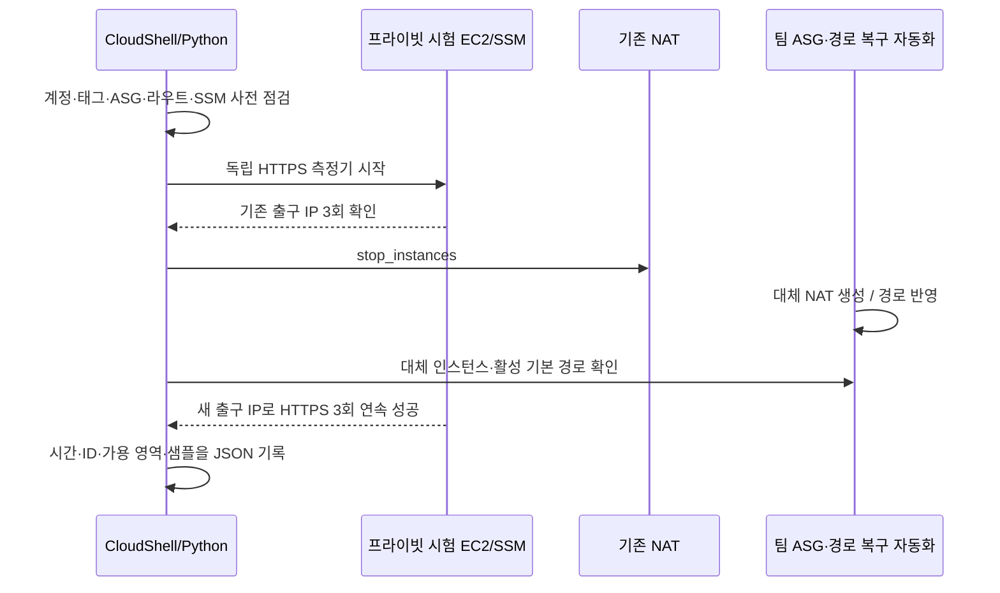

# NAT 장애·자동 복구 검증 자동화

**해커톤 · 김준백 담당 Python 검증 도구**

NAT 인스턴스 장애 이후 ASG 대체 인스턴스와 기본 경로가 정상화되는지, 프라이빗 EC2가 실제로 새 NAT를 통해 외부 HTTPS에 접근하는지 측정한 코드입니다. 사전 점검부터 장애 주입·복구 관측·JSON 기록까지 반복 절차를 도구로 정리했습니다.

## 개인 역할과 팀 구현 구분

담당 코드는 Boto3 기반 상태 조회, 시험 조건 검사, SSM 측정기 실행, NAT 중지 요청, 대체 인스턴스·라우팅·외부 통신 검증 및 결과 기록입니다.

ASG, NAT 네트워크, 대체 NAT의 라우팅 전환 자동화는 팀 환경의 전제 조건입니다. 이 저장소에 해당 환경 전체 구축 코드나 라우팅 변경 Lambda는 포함되어 있지 않습니다. **검증 스크립트 자체가 새 NAT를 생성하거나 라우팅을 고치는 것은 아닙니다.**

## 구조



## 코드 안내

| 파일/함수 | 역할 |
|---|---|
| [src/nat-demo.py](src/nat-demo.py) | 현재 NAT를 ASG에서 찾아 검사하는 후속 시험 도구 |
| [archive/nat-stop-test.py](archive/nat-stop-test.py) | 기존 NAT ID가 고정돼 있던 이전 버전. 개발 이력 참고용 |
| `require()` | 시험 전제나 결과가 맞지 않으면 즉시 중단 |
| `group()`, `instance()` | ASG 구성과 EC2 상태 조회 |
| `routed_to()` | 활성 기본 경로가 대상 인스턴스 또는 ENI를 향하는지 검사 |
| `remote()` | SSM 명령 전달·상태 폴링·표준 출력 수집 |
| `main()` | check/run 분기와 전체 시험 순서·제한 시간·결과 저장 |

## 사전 점검과 측정 방법

계정과 대상 태그, ASG 최소/희망/최대 1대, Healthy/InService NAT 한 대, 기존 NAT 실행 상태, 활성 기본 경로, SourceDestCheck 비활성화, 시험 EC2의 프라이빗 배치와 SSM Online을 확인합니다. 시험 대상 NAT와 측정 EC2가 같으면 중단합니다.

`check`는 상태 조회만 수행합니다. `run`은 프라이빗 EC2에 `systemd-run` 측정기를 먼저 시작하고, 기존 NAT의 출구 IP를 세 차례 확인한 후 기존 NAT를 중지합니다. 측정기는 `https://checkip.amazonaws.com`에 최대 4초 제한을 두고 요청하며 각 요청 뒤 5초 대기합니다. 요청 시간 때문에 정확한 5초 고정 주기는 아닙니다.

대체 NAT와 활성 경로가 관찰되고 새 출구 IP로 세 번 연속 HTTPS 성공하면 종료합니다. 최대 관측 시간은 25분입니다. 장애가 관찰되지 않은 경우 이를 임의로 장애 시간 0초라고 단정하지 않고 `failure_observed`로 구분합니다.

## 결과 필드와 해석

| JSON 필드 | 의미 |
|---|---|
| `stop_request_epoch` | NAT 중지 요청 직전 기록 시각 |
| `route_active` | 대체 인스턴스를 향한 경로 관찰 여부 |
| `https_confirmed` | 새 출구 IP로 세 번 연속 HTTPS 성공 |
| `failure_observed` | 장애 이후 샘플에서 FAIL 관찰 여부 |
| `stop_to_confirmation_seconds` | 중지 요청부터 마지막 성공 샘플까지 |
| `first_fail_to_confirmation_seconds` | FAIL이 관찰된 경우 최초 FAIL부터 마지막 성공 샘플까지 |
| `old_az`, `new_az`, `samples` | 가용 영역 변경과 원본 측정 샘플 |

두 시간 필드는 시작점이 다릅니다. 샘플 기반 측정이며 애플리케이션 전체의 정밀 RTO와 동일하지 않습니다. 과거 발표 자료의 수치는 당시 실행 기록과 함께 확인해야 하며, 공개 정리 과정에서 실환경 장애를 다시 주입하지 않았습니다.

## 실행 환경

Python, Boto3/Botocore, AWS CloudShell, EC2, Auto Scaling, SSM, Linux systemd, Bash/curl을 사용했습니다.

```bash
python -m pip install -r requirements.txt
python -m py_compile src/nat-demo.py
# 실습 환경별 TEST/GROUP/TABLE, 계정 검사값과 서브넷을 준비한 뒤에만:
python src/nat-demo.py check
# 승인된 장애 실습에서만 run 사용: 기존 NAT 인스턴스를 실제로 중지함
```

공개본의 리소스 ID와 계정은 예시 값입니다. 실제 계정에 대한 사전 점검과 변경 권한, 팀의 ASG·라우팅 복구 구성, SSM 실행 대상이 필요합니다. 인증 키와 실제 실행 JSON은 포함하지 않았습니다.

## 검증 수준과 개선 과제

현재 파일은 당시 시험 절차를 담은 코드이며, 공개 정리에서 수행한 검증은 Python 문법 검사입니다. 원본 실환경 출력 전체는 이 저장소에 없으므로 새로운 성공 횟수나 평균 복구 시간을 제시하지 않습니다.

후속 과제는 환경변수·설정 파일로 대상 분리, Boto3 모의 단위 테스트, 반복 시험의 시간 분포와 실패 유형 비교입니다. 당시 실험 결과와 이번 공개 과정의 정적 검사를 혼동하지 않습니다.

다른 프로젝트: [1차 AWS 복구](https://github.com/Kimjunbaek/aws-recovery-automation) · [2차 BEET](https://github.com/Kimjunbaek/beet-openstack-autoscaling)
